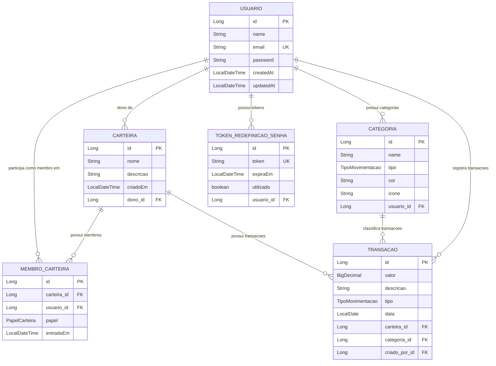

# NodeBank - Sistema de Controle Financeiro

Sistema completo de controle financeiro pessoal e compartilhado desenvolvido como aplicação Fullstack (Backend Spring Boot 4.1 + Frontend React 19).

---

## 📌 Descrição da Aplicação e Arquitetura

O **NodeBank** permite que usuários controlem suas finanças pessoais e gerenciem carteiras compartilhadas com múltiplos membros, oferecendo acompanhamento de receitas, despesas, categorização de lançamentos e análise visual por meio de gráficos de evolução e relatórios consolidados em tempo real.

### Arquitetura do Sistema

```
Controle-Financeiro/
├── backend/                       # REST API Spring Boot 4.1
│   ├── src/main/java/controle_financeiro/backend/
│   │   ├── controller/            # Controllers REST (Exposição dos Endpoints)
│   │   ├── service/               # Camada de Regras de Negócio e Transações
│   │   ├── repository/            # Interfaces Spring Data JPA e Specifications
│   │   ├── model/                 # Entidades JPA (Usuario, Carteira, Categoria, Transacao, MembroCarteira)
│   │   ├── dto/                   # Data Transfer Objects com Bean Validation
│   │   ├── security/              # Filtro JWT (OncePerRequestFilter) e SecurityConfig
│   │   ├── exception/             # GlobalExceptionHandler (@ControllerAdvice) e Exceções Customizadas
│   │   └── config/                # Swagger / OpenAPI e configurações gerais
│   └── pom.xml                    # Gerenciador de Dependências Maven
│
└── frontend/                      # Single Page Application (SPA) React 19 + Vite
    ├── src/
    │   ├── assets/                # Imagens e Vetores (Logo NodeBank)
    │   ├── components/            # Componentes Reutilizáveis (Sidebar, CategoryIcon)
    │   ├── config/                # Configuração do Axios Client e Interceptors JWT
    │   ├── pages/                 # Páginas (Login, Register, Dashboard, ForgotPassword, ResetPassword, ChangePassword)
    │   ├── routes/                # Gerenciamento de Rotas Protegidas (PrivateRoute)
    │   └── services/              # Camada de Serviços de API (authService, walletService, transactionService, categoryService)
    └── package.json
```

### 📊 Diagrama de Entidades (Modelagem de Dados JPA)



---

## Configuração local

Pré-requisitos: Java 21, Maven Wrapper incluído em backend/, MySQL em localhost:3306 e Node.js compatível com frontend/package-lock.json (Node 22.12+).

O projeto usa MySQL; não há driver PostgreSQL nem perfil H2 configurado.

Na raiz do projeto, copie os exemplos (PowerShell):

~~~powershell
Copy-Item backend/.env.example backend/.env
Copy-Item frontend/.env.example frontend/.env
~~~

Se os arquivos já existirem, edite-os sem sobrescrever suas configurações.

O backend importa backend/.env como Java Properties quando iniciado **dentro de backend/**. Na IDE, configure essa pasta como diretório de trabalho. Use CHAVE=valor, sem export e sem aspas (aspas seriam parte do valor). Variáveis do sistema têm precedência. O antigo application-secrets.properties não é mais importado automaticamente.

| Variável | Configuração |
| --- | --- |
| SPRING_DATASOURCE_URL | URL JDBC MySQL; banco controle_financeiro no exemplo |
| SPRING_DATASOURCE_USERNAME | Usuário MySQL; padrão local root |
| SPRING_DATASOURCE_PASSWORD | Senha conforme sua instalação MySQL |
| SPRING_MAIL_HOST / SPRING_MAIL_PORT | SMTP; padrões smtp.gmail.com / 587 |
| SPRING_MAIL_USERNAME / SPRING_MAIL_PASSWORD | Credenciais para recuperação de senha; no Gmail, senha de app |
| JWT_SECRET | Obrigatório: chave aleatória com pelo menos 32 bytes UTF-8 |
| JWT_EXPIRATION | Validade em milissegundos; padrão 86400000 (24 horas) |
| VITE_API_BASE_URL | Em frontend/.env; API pública, padrão http://localhost:8080 |

Gere uma chave JWT e copie o resultado para JWT_SECRET:

~~~sh
node -e "console.log(require('crypto').randomBytes(32).toString('hex'))"
~~~

A URL local usa createDatabaseIfNotExist=true, o que requer permissão de criação. Caso necessário, crie o banco previamente:

~~~sql
CREATE DATABASE controle_financeiro;
~~~

O Hibernate cria/atualiza as tabelas com ddl-auto=update. A recuperação de senha requer SMTP válido. O link de recuperação aponta para localhost:5173; outras URLs exigem ajustes em UsuarioService e SecurityConfig (CORS).

Os arquivos .env e o secrets real são ignorados pelo Git; versione apenas os exemplos. Como alternativa ao .env, consulte [application-secrets-example.properties](backend/src/main/resources/application-secrets-example.properties), com instruções para carregar o secrets explicitamente. Nunca coloque senhas ou JWT em variáveis VITE_, pois são expostas no navegador.

---

## 🚀 Como Executar a Aplicação Localmente

### 1. Executando o Backend (Spring Boot)

Abra um terminal na raiz da pasta `backend`:

```bash
cd backend

# No Linux/macOS:
./mvnw spring-boot:run

# No Windows (Command Prompt / PowerShell):
.\mvnw.cmd spring-boot:run
```

O servidor backend iniciará e estará pronto para receber requisições na porta **`8080`**: `http://localhost:8080`.

---

### 2. Executando o Frontend (React + Vite)

Abra outro terminal na raiz da pasta `frontend`:

```bash
cd frontend

# Instala as dependências (primeira vez)
npm install

# Inicia o servidor de desenvolvimento Vite
npm run dev
```

A aplicação web estará acessível no navegador pelo endereço: **`http://localhost:5173`** (confira a porta informada pelo Vite).

---

## 📚 Documentação Swagger / OpenAPI

Com a aplicação backend em execução, você pode visualizar e testar interativamente todos os endpoints REST através da interface do Swagger UI:

* **Swagger UI**: [http://localhost:8080/swagger-ui.html](http://localhost:8080/swagger-ui.html) ou [http://localhost:8080/swagger-ui/index.html](http://localhost:8080/swagger-ui/index.html)
* **OpenAPI JSON Spec**: [http://localhost:8080/v3/api-docs](http://localhost:8080/v3/api-docs)

---

## 💡 Decisões de Projeto Relevantes

### 1. Autenticação Stateless com JWT e claims estendidas
Optou-se pela utilização do Spring Security com sessão **Stateless** e assinado via **JJWT (0.12.6)** com algoritmos HMAC-SHA256. A claim `name` foi incluída no payload do JWT juntamente com `sub` (userId) e `email`, permitindo que o cliente web saiba imediatamente o nome do usuário sem exigir uma requisição adicional.

### 2. Interceptor Centralizado no Cliente Axios
No frontend, o arquivo `axiosConfig.js` possui um interceptor de requisições que insere automaticamente o cabeçalho `Authorization: Bearer <token>` extraído do `localStorage`. Isso centralizou o controle de segurança e eliminou código repetitivo nos serviços.

### 3. Modelo de Permissões de Membros da Carteira (`DONO`, `EDITOR`, `VISUALIZADOR`)
Para suporte a carteiras compartilhadas, foi criada a entidade `MembroCarteira` com a enumeração `PapelCarteira`:
* **`DONO`**: Acesso total, incluindo permissão de exclusão da carteira, adição e alteração de papéis dos membros.
* **`EDITOR`**: Permissão de leitura e escrita (criação, edição e remoção de lançamentos/transações).
* **`VISUALIZADOR`**: Permissão estritamente de leitura (bloqueado em tentativas de modificação com erro HTTP 403).

### 4. Trava de Exclusão de Categorias e Retorno HTTP 422
Visando a integridade dos dados financeiros, a exclusão de uma categoria é interrompida via `BusinessException` caso existam lançamentos vinculados a ela. Essa exceção é capturada pelo `GlobalExceptionHandler` e devolve exatamente o status **422 Unprocessable Entity** com mensagem descritiva.

### 5. Geração Automática de Categorias Padrão no Cadastro
No momento em que o método `cadastrar()` do `UsuarioService` salva um novo usuário, o sistema gera automaticamente 6 categorias iniciais (Salário, Investimentos, Alimentação, Transporte, Moradia, Lazer) dentro da mesma transação atômica, permitindo o uso imediato sem telas em branco.

### 6. Encapsulamento de Estilos do Componente Sidebar
Para evitar vazamento ou sobreposição de regras de CSS entre páginas autenticadas e telas centralizadas (como troca de senha e recuperação), os estilos do menu lateral foram isolados em `Sidebar.css` e importados diretamente pelo componente `<Sidebar />`.

---

## 📝 Licença

Projeto desenvolvido para a disciplina de Programação Web / Controle Financeiro.
