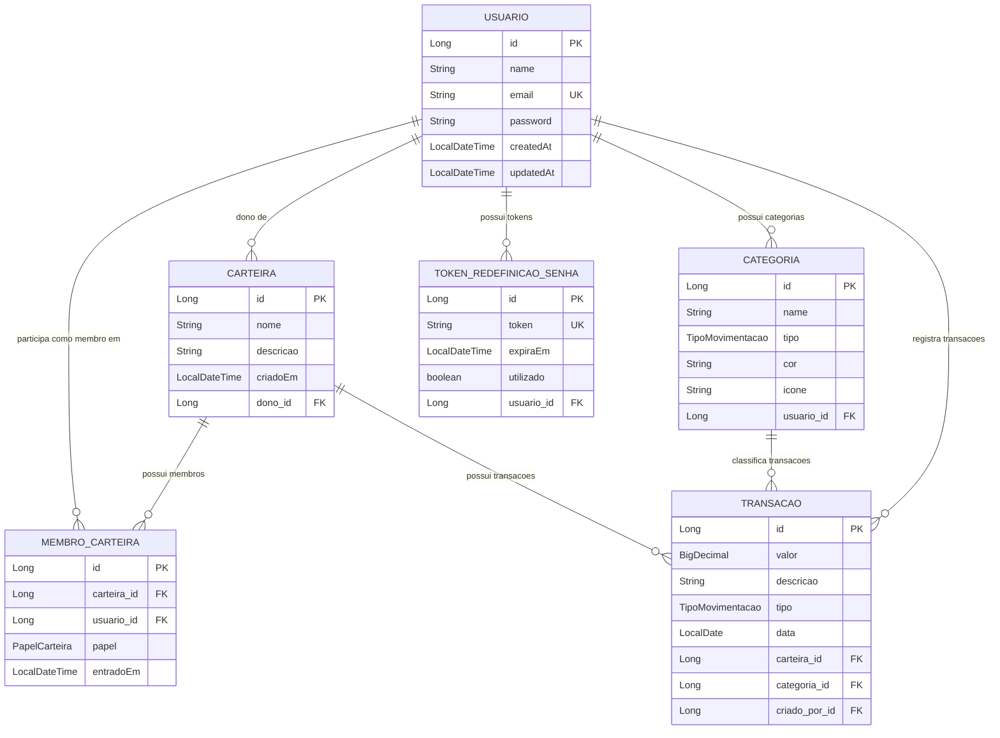

# NodeBank - Sistema de Controle Financeiro

Sistema completo de controle financeiro pessoal e compartilhado desenvolvido como aplicação Fullstack (Backend Spring Boot 3.x + Frontend React 18).

---

## 📌 Descrição da Aplicação e Arquitetura

O **NodeBank** permite que usuários controlem suas finanças pessoais e gerenciem carteiras compartilhadas com múltiplos membros, oferecendo acompanhamento de receitas, despesas, categorização de lançamentos e análise visual por meio de gráficos de evolução e relatórios consolidados em tempo real.

### Arquitetura do Sistema

```
Controle-Financeiro/
├── backend/                       # REST API Spring Boot 3.x
│   ├── src/main/java/controle_financeiro/backend/
│   │   ├── controller/            # Controllers REST (Exposição dos Endpoints)
│   │   ├── service/               # Camada de Regras de Negócio e Transações
│   │   ├── repository/            # Interfaces Spring Data JPA e Specifications
│   │   ├── model/                 # Entidades JPA (Usuario, Carteira, Categoria, Transacao, MembroCarteira)
│   │   ├── dto/                   # Data Transfer Objects com Bean Validation
│   │   ├── security/              # Filtro JWT (OncePerRequestFilter) e SecurityConfig
│   │   ├── exception/             # GlobalExceptionHandler (@ControllerAdvice) e Exceções Customizadas
│   │   └── config/                # Swagger / OpenAPI e configurações gerais
│   └── pom.xml                    # Gerenciador de Dependências Maven
│
└── frontend/                      # Single Page Application (SPA) React 18 + Vite
    ├── src/
    │   ├── assets/                # Imagens e Vetores (Logo NodeBank)
    │   ├── components/            # Componentes Reutilizáveis (Sidebar, CategoryIcon)
    │   ├── config/                # Configuração do Axios Client e Interceptors JWT
    │   ├── pages/                 # Páginas (Login, Register, Dashboard, ForgotPassword, ResetPassword, ChangePassword)
    │   ├── routes/                # Gerenciamento de Rotas Protegidas (PrivateRoute)
    │   └── services/              # Camada de Serviços de API (authService, walletService, transactionService, categoryService)
    └── package.json
```

### 📊 Diagrama de Entidades (Modelagem de Dados JPA)



---

## 🛠️ Pré-requisitos

Para compilar e executar o projeto localmente, certifique-se de ter instalado em sua máquina:

* **Java 21 LTS** ou superior
* **Maven 3.8+** (ou utilizar o wrapper `./mvnw` incluso na pasta do backend)
* **Node.js 18+** e **npm 9+**
* **PostgreSQL 15+** (opcional, H2 Database em memória já vem ativado no perfil de desenvolvimento/testes)

---

## 🗄️ Instruções para Criar o Banco de Dados e Configurar Variáveis de Ambiente

### 1. Criar o Banco de Dados no PostgreSQL

Abra o terminal SQL (pgAdmin, DBeaver ou psql) e execute o comando abaixo para criar o banco de dados:

```sql
CREATE DATABASE controle_financeiro;
```

### 2. Configurar as Variáveis de Ambiente

No backend, as configurações de banco de dados e segredo de autenticação JWT ficam centralizadas no arquivo [`backend/src/main/resources/application.properties`](file:///c:/Users/Giovana/OneDrive/WorkSpace/PW/Controle-Financeiro/backend/src/main/resources/application.properties):

```properties
# Configurações da Aplicação
spring.application.name=backend
server.port=8080

# Conexão com o Banco de Dados PostgreSQL
spring.datasource.url=${SPRING_DATASOURCE_URL:jdbc:postgresql://localhost:5432/controle_financeiro}
spring.datasource.username=${SPRING_DATASOURCE_USERNAME:postgres}
spring.datasource.password=${SPRING_DATASOURCE_PASSWORD:postgres}
spring.datasource.driver-class-name=org.postgresql.Driver

# Configurações do JPA / Hibernate
spring.jpa.hibernate.ddl-auto=update
spring.jpa.show-sql=true
spring.jpa.properties.hibernate.format_sql=true

# Configuração do JWT (Segredo de 256-bits e expiração de 24 horas)
jwt.secret=${JWT_SECRET:ChaveSecretaSuperSeguraComPeloMenos256BitsDeComprimentoParaAlgoritmoHS256}
jwt.expiration=${JWT_EXPIRATION:86400000}
```

> **Nota**: Você pode alterar os valores padrão diretamente no arquivo ou definir as variáveis de ambiente `SPRING_DATASOURCE_URL`, `SPRING_DATASOURCE_USERNAME`, `SPRING_DATASOURCE_PASSWORD` e `JWT_SECRET` em seu sistema operacional.

---

## 🚀 Como Executar a Aplicação Localmente

### 1. Executando o Backend (Spring Boot)

Abra um terminal na raiz da pasta `backend`:

```bash
cd backend

# No Linux/macOS:
./mvnw spring-boot:run

# No Windows (Command Prompt / PowerShell):
.\mvnw.cmd spring-boot:run
```

O servidor backend iniciará e estará pronto para receber requisições na porta **`8080`**: `http://localhost:8080`.

---

### 2. Executando o Frontend (React + Vite)

Abra outro terminal na raiz da pasta `frontend`:

```bash
cd frontend

# Instala as dependências (primeira vez)
npm install

# Inicia o servidor de desenvolvimento Vite
npm run dev
```

A aplicação web estará acessível no navegador pelo endereço: **`http://localhost:5173`** (ou `http://localhost:3000`).

---

## 📚 Documentação Swagger / OpenAPI

Com a aplicação backend em execução, você pode visualizar e testar interativamente todos os endpoints REST através da interface do Swagger UI:

* **Swagger UI**: [http://localhost:8080/swagger-ui.html](http://localhost:8080/swagger-ui.html) ou [http://localhost:8080/swagger-ui/index.html](http://localhost:8080/swagger-ui/index.html)
* **OpenAPI JSON Spec**: [http://localhost:8080/v3/api-docs](http://localhost:8080/v3/api-docs)

---

## 💡 Decisões de Projeto Relevantes

### 1. Autenticação Stateless com JWT e claims estendidas
Optou-se pela utilização do Spring Security com sessão **Stateless** e assinado via **JJWT (0.12.6)** com algoritmos HMAC-SHA256. A claim `name` foi incluída no payload do JWT juntamente com `sub` (userId) e `email`, permitindo que o cliente web saiba imediatamente o nome do usuário sem exigir uma requisição adicional.

### 2. Interceptor Centralizado no Cliente Axios
No frontend, o arquivo `axiosConfig.js` possui um interceptor de requisições que insere automaticamente o cabeçalho `Authorization: Bearer <token>` extraído do `localStorage`. Isso centralizou o controle de segurança e eliminou código repetitivo nos serviços.

### 3. Modelo de Permissões de Membros da Carteira (`DONO`, `EDITOR`, `VISUALIZADOR`)
Para suporte a carteiras compartilhadas, foi criada a entidade `MembroCarteira` com a enumeração `PapelCarteira`:
* **`DONO`**: Acesso total, incluindo permissão de exclusão da carteira, adição e alteração de papéis dos membros.
* **`EDITOR`**: Permissão de leitura e escrita (criação, edição e remoção de lançamentos/transações).
* **`VISUALIZADOR`**: Permissão estritamente de leitura (bloqueado em tentativas de modificação com erro HTTP 403).

### 4. Trava de Exclusão de Categorias e Retorno HTTP 422
Visando a integridade dos dados financeiros, a exclusão de uma categoria é interrompida via `BusinessException` caso existam lançamentos vinculados a ela. Essa exceção é capturada pelo `GlobalExceptionHandler` e devolve exatamente o status **422 Unprocessable Entity** com mensagem descritiva.

### 5. Geração Automática de Categorias Padrão no Cadastro
No momento em que o método `cadastrar()` do `UsuarioService` salva um novo usuário, o sistema gera automaticamente 6 categorias iniciais (Salário, Investimentos, Alimentação, Transporte, Moradia, Lazer) dentro da mesma transação atômica, permitindo o uso imediato sem telas em branco.

### 6. Encapsulamento de Estilos do Componente Sidebar
Para evitar vazamento ou sobreposição de regras de CSS entre páginas autenticadas e telas centralizadas (como troca de senha e recuperação), os estilos do menu lateral foram isolados em `Sidebar.css` e importados diretamente pelo componente `<Sidebar />`.

---

## 📝 Licença

Projeto desenvolvido para a disciplina de Programação Web / Controle Financeiro.
